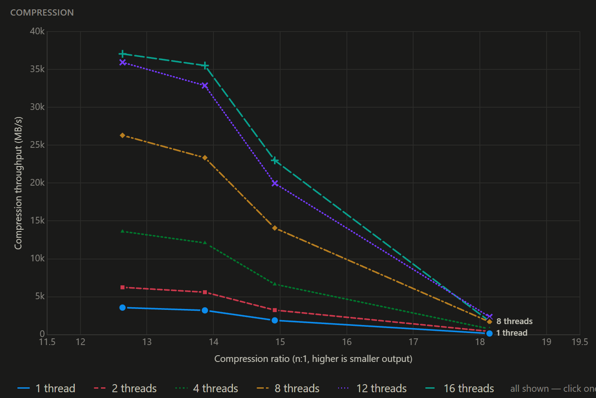
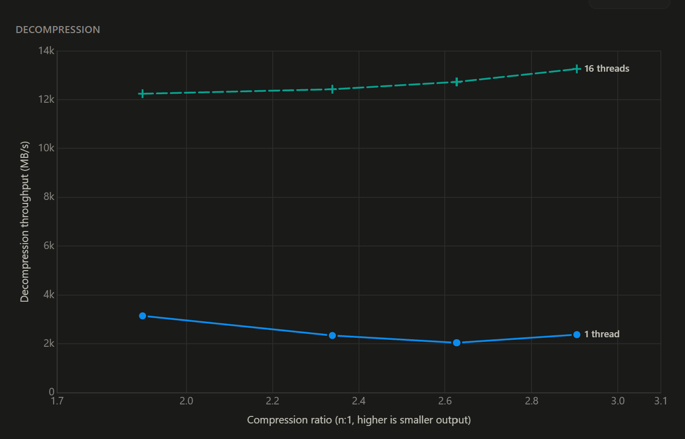
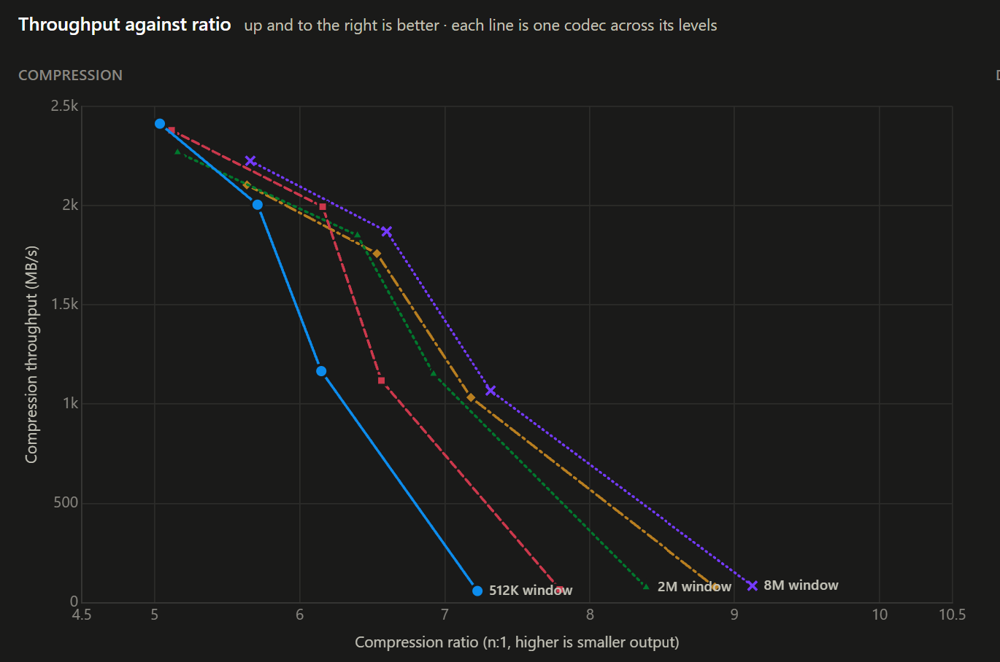
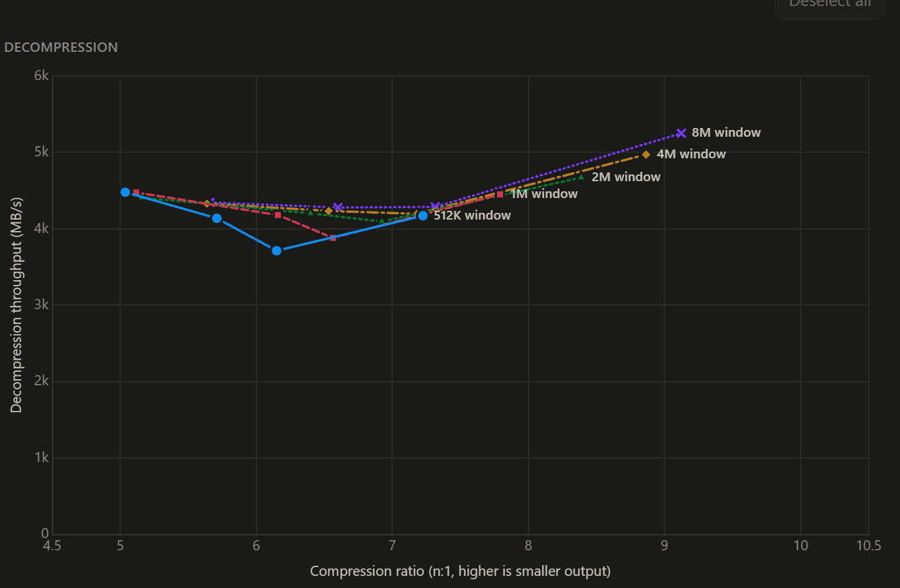

<!-- CC BY-SA Klaus Post https://creativecommons.org/licenses/by-sa/4.0/deed.en -->

<!-- 
theme: gaia
class: 
    - lead
paginate: false
-->

<!-- size: 16:9 -->

# Go Data Compression

Klaus Post @ Golab 2026

Slides: https://golab2026.klauspost.com

100% meat-generated

---

# Data Compression Primer

Minimize transfer and storage

Always a CPU/size tradeoff

Sometimes Compatibility 

---

# Generic Compression
# Domain Specific

---

# Match Coding

String of Operations

Literals and back-references

Main compression scheme

[Example](block-vis/index.html)

---

# Entropy Coding

Symbols (bytes) -> Bit Stream

* Huffman
* Range Coding
* ANS

Completely unordered

---

# Transformers 

(no, not those)

Usually doesn't compress by itself.

Example: Columnar data

---

# Context Mixing / LLM

Select Encoder based on history.

Good. Exotic. (Too) Slow.

---

# Benchmarking

Dimensions:
* Speed
* Compression Ratio
* Memory Usage
* Comp vs Decomp
* Representative test data
* CPU/memory

---

# [Let's see some](http://127.0.0.1:8080/#c=silesia&m=1omrle93&t=1&op=c)

---

[Threads Compression](http://127.0.0.1:8080/#c=apache-log&m=1omrle93&t=1,2,4,8,12,16&by=threads&cd=minlz)

---

[Threads Decompression](http://127.0.0.1:8080/#c=apache-log&m=1omrle93&t=1,2,4,8,12,16&by=threads&cd=minlz)

---

Window Size Compression

---

Window Size Decompression

---

# DEFLATE

Create by Phil Katz for PKZIP

Huffman Stream with either a literal or a match.

---

# Go 1.27 Improvements

- Custom level 1-6 encoders
- Huffman Encoding
- Level 7-9 tweaks

---

# Stdlib Zstandard

WIP - slow but steady.

---

# Third Party - Byte Aligned

| Compressor | Main Upsides                | Main Downside      |
|------------|-----------------------------|--------------------|
| Snappy     | +Compatible, OK Speed       | Low Compression    |
| LZ4        | +Compatible, +Speed, Simple | Low Compression    |
| MinLZ      | +Speed, Backcompat          | Medium Compression |

---

# Third Party - Bit Aligned

| Compressor     | Main Upsides                      | Main Downside                           |
|----------------|-----------------------------------|-----------------------------------------|
| gzip (deflate) | +Compatible                       | Slow decompression, Medium compresssion |
| bzip2          | Compatible                        | Very Slow                               |
| zstd           | Compatible, Size, Speed, Versaile | Good, not great decompression           |
| brotli         | HTML, Size                        | Rarely the best, except when very slow  |

---

# MinLZ SIMD Blocks

Design a compressor purely around SIMD operations

Goal: Entropy coding with minimal extra CPU

Achieved: Entropy coding with 2x-3x faster decompression

ADD BLOCK DIAGRAM

---

# Q & A

---

# Thank You!

Klaus Post @ Golab 2026

`𝕏: @sh0dan`
`🦋: @klauspost.com`

